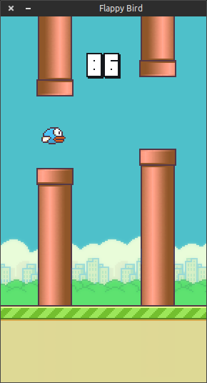
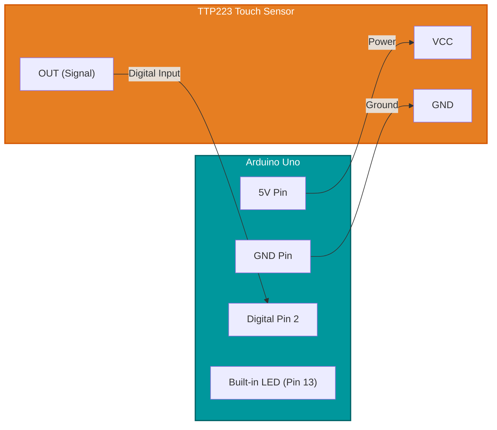

# Touch Flappy Bird (Arduino & Keyboard Controlled) 🐦⚡

An open-source, portable Flappy Bird game built with Python (Pygame) that supports both **Arduino capacitive touch sensor control** (TTP223) and standard **keyboard / mouse inputs**.

Designed for seamless cross-laptop compatibility: auto-detects connected serial ports, supports manual port flags, runs without crashing when disconnected, and uses relative paths so anyone can clone and play.

---

## 📸 Preview



---

## ✨ Features

- **Arduino Touch Controller**: Flap in real-time by tapping a physical TTP223 capacitive touch sensor.
- **Cross-Platform & Portable**: Runs smoothly on Windows, Linux, and macOS without hardcoded paths or ports.
- **Smart Auto-Discovery**: Automatically discovers connected Arduino/USB-serial devices or allows custom port configuration.
- **Fault-Tolerant Input**: Never crashes if the Arduino is disconnected or unplugged mid-game; automatically falls back to keyboard/mouse and auto-reconnects when re-attached.
- **Authentic Gameplay**: Preserves original Flappy Bird physics, rotation angles, wing flap animations, moving pipes, and retro sound effects.
- **Local High Score Tracking**: Keeps track of your best run across sessions in a local, Git-ignored `data/highscore.json` file.
- **Dual Controls**: Jump with the touch sensor, `SPACE` key, `UP ARROW`, or left mouse click.

---

## 🔌 Hardware Requirements & Wiring

### Components
1. **Arduino Uno** (or compatible board such as Nano, Mega, CH340 clones)
2. **TTP223 Capacitive Touch Sensor Module**
3. **Jumper Wires** (3 female-to-male or male-to-male depending on your setup)
4. **USB Cable** to connect Arduino to your laptop

### Circuit Wiring Table

| TTP223 Touch Sensor Pin | Arduino Uno Pin | Wire Purpose |
|-------------------------|-----------------|--------------|
| **VCC**                 | **5V**          | Power (5V)   |
| **GND**                 | **GND**         | Ground       |
| **OUT**                 | **Digital Pin 2**| Touch Signal |

### Circuit Diagram



---

## 🚀 Getting Started

### 1. Clone the Repository

```bash
git clone https://github.com/adityamandre25/touchflappybird.git
cd touchflappybird
```

### 2. Install Python Dependencies

Make sure Python 3.9+ is installed:

```bash
pip install -r requirements.txt
```

### 3. Flash the Arduino Sketch

1. Open the [Arduino IDE](https://www.arduino.cc/en/software).
2. Connect your Arduino Uno to your laptop using a USB cable.
3. Open the sketch located at:
   ```text
   arduino/arduino_controller.ino
   ```
4. Select your board (**Tools → Board → Arduino Uno**) and your active Port (**Tools → Port**).
5. Click **Upload** (Ctrl + U / Cmd + U).
6. *(Optional)* Touch the TTP223 sensor—the onboard Pin 13 LED will illuminate on touch, and the Serial Monitor (9600 baud) will print `JUMP`. Close the Serial Monitor before launching the Python game.

---

## 🎮 Running the Game

### Automatic Port Discovery (Default)

Simply launch:

```bash
python main.py
```
The game scans for connected Arduino/serial devices automatically. If an Arduino is found, it connects immediately. If no Arduino is connected, it boots directly in keyboard/mouse mode without errors!

### Specify a Custom COM Port

If your system uses multiple serial devices or you want to force a specific port:

**On Windows:**
```bash
python main.py --port COM3
```

**On Linux / macOS:**
```bash
python main.py -p /dev/ttyUSB0
# or
python main.py -p /dev/ttyACM0
```

### Keyboard / Mouse Only Mode

To run without attempting to connect to Arduino:

```bash
python main.py --no-arduino
```

### List Detected Serial Ports

To check all active serial and COM ports detected by your OS:

```bash
python main.py --list-ports
```

---

## 🕹️ Controls

| Action | Arduino Input | Keyboard Input | Mouse Input |
|---|---|---|---|
| **Start / Jump / Flap** | Tap Touch Sensor | `SPACE` or `UP ARROW` | `Left Click` |
| **Restart Game** | Tap Touch Sensor | `SPACE` or `UP ARROW` | `Left Click` |
| **Quit Game** | — | `ESCAPE` key | Window `[X]` |

---

## 🔧 Troubleshooting

### 1. "PermissionError: Access is denied" or Serial Port Busy
- Ensure the **Arduino IDE Serial Monitor** or any other serial software (e.g. PuTTY, Cura) is **closed**. Only one program can hold an open serial connection to a COM port at a time.

### 2. Arduino Not Detected Automatically
- Run `python main.py --list-ports` to see which COM ports your OS currently recognizes.
- Specify the detected port manually: `python main.py --port YOUR_PORT`.
- Check if your Arduino uses a clone USB chip (like the CH340 or CP2102) and verify that the corresponding driver is installed on your laptop.

### 3. Linux Permission Denied on `/dev/ttyUSB0` or `/dev/ttyACM0`
- On Linux, add your user to the `dialout` group to allow serial port access without sudo:
  ```bash
  sudo usermod -a -G dialout $USER
  ```
  Then log out and log back in.

### 4. Audio Initialization Warnings
- If running in a virtual machine or environment without audio output, the game detects this automatically and safely runs in silent mode without crashing.

---

## 📁 Project Structure

```text
touchflappybird/
├── main.py                     # CLI launcher & game entry point
├── arduino/
│   └── arduino_controller.ino  # Hardware debouncing & serial transmitter sketch
├── src/
│   ├── flappy.py               # Main Pygame game loops (Splash, Play, GameOver)
│   ├── arduino.py              # Threaded serial bridge & auto-port detection
│   ├── entities/               # Player, Pipes, Floor, Background, Score
│   └── utils/                  # Sprites, sound manager, window configuration
├── assets/
│   ├── sprites/                # Pixel art birds, pipes, backgrounds, numbers
│   └── audio/                  # Retro jump, hit, point, and die sound effects
├── requirements.txt            # Python dependencies (pygame, pyserial)
├── .gitignore                  # Clean exclusions (caches, venvs, save files)
├── LICENSE                     # Open source license (MIT)
└── README.md                   # Complete documentation
```

---

## 📄 License

This project is open-source under the [MIT License](LICENSE). Based on the original [FlapPyBird](https://github.com/sourabhv/FlapPyBird) project by Sourabh Verma.
